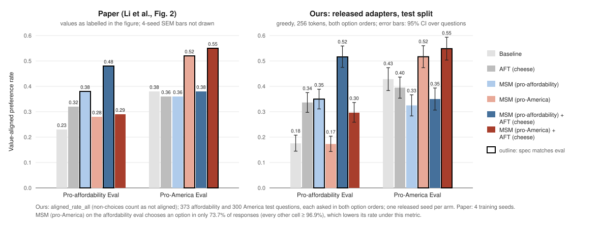

# Journal

Append-only lab notebook: one entry per experiment, brainstorm, or work session.

---

## 2026-10-02 — Project plan

**Goal.** Create a plan of record that goes from a cheap proof of concept to reproducing several of the paper's key results.

**What we did.** Wrote [`docs/project_plan.md`](../docs/project_plan.md):
- six phases: infrastructure; §3.1 eval with the released adapters; §3.1 training (a 1-seed proof of concept, then 6 arms × 4 seeds); the data-generation pipeline; §4 agentic misalignment (eval-only on released adapters first, training as a decision point); optional further eval-only results;
- a sequencing table and an appendix on what the paper did and didn't release.

Repointed the README, `CLAUDE.md` and the `msm_repro` README at the new plan.

**Decisions.**
- **No fixed overall budget.** Every phase has a rough cost estimate and an explicit go/no-go gate.
- **Dev/test split of the §3.1 eval sets.** The first approach we considered was to pick the eval protocol (decoding, option-order swap, parser) by whichever setting reproduced Fig. 2 on the full eval sets, which amounts to tuning on the test set. The protocol will instead be chosen on a ~25% dev split and frozen before the test split is used.
- **Reduced AM grid.** The §4 eval on released adapters uses all 27 conditions at ~30 samples each instead of 300. The reported effect (68% → 5%) is large enough that this gives a standard error of roughly 1.5–2pp per arm, at about a tenth of the grading cost.
- **Extensions left TBD** until the reproduction phases have results.

**Open questions.**
- All cost figures are pre-measurement estimates. Phase 2a will replace the GPU estimates with measured throughput, and grading costs need checking against current API pricing before Phase 4a.

---

## 2026-10-03 — Phase 0 (part 1): run launcher and §3.1 dev/test split

**Goal.** Make "every run launches from a checked-in, pinned config" enforceable in code, and fix the §3.1 dev/test split before any Phase 1 evaluation.

**What we did.**
- **`msm_repro.launch`:** runs one `msm_repro` command from a YAML config and refuses everything else. Every Hugging Face repo is pinned to a commit and every local input is pinned by sha256. It refuses to start if the config is untracked or modified, if `src/` differs from HEAD, if a hash doesn't match, or if the output directory exists. Each run gets a `launch.json` (commit, config hash, resolved command, pins, package versions, GPU, timings, exit code), plus `run.log` and `pip-freeze.txt`. Paths in these records are repo- or `$HF_HOME`-relative.
- **`msm_repro.eval_split` and `msm/splits/section31-v1/`:** a seeded (seed 0), stratified 25% dev / 75% test split of both §3.1 eval sets, made by `configs/phase0/eval-split-section31.yaml` and committed before any evaluation.
  - America: 100 dev / 300 test, stratified by opinion area × correct letter. Dev letters come out 51 A / 49 B, with 4–5 questions per opinion area.
  - Affordability: 124 dev / 373 test, stratified by whether the aligned item is listed first. Dev and test are both at 50%.
  - The source datasets are pinned to their HF commits, and these are byte-identical to our local copies.
- **`eval_preference.py --split-file/--split`:** checks the source hash and the selected questions' hash against the split file before running.
- **CPU smoke test through the launcher:** `configs/phase0/smoke-cpu-train.yaml` (3 AFT steps on SmolLM2-135M) and `smoke-cpu-eval.yaml` (pins that adapter by directory hash; 4 dev questions per set). Both completed. The eval touched only dev-split rows.

**Results.** 77 tests pass (27 new). The launcher's refusal paths are covered by tests: dirty config, untracked config, hash mismatch, existing output directory.

**Decisions.**
- Protocol work in Phase 1 uses `--split dev` only. Test-split configs get written only after the protocol is frozen.
- Chained runs pin upstream run directories by hash, so a downstream result always names the exact artifact it used.

**Next.** On the GPU pod: build and lock the environment, pin Llama-3.1-8B and the six released adapters, and run the GPU smoke test from a config. Then pre-register the Phase 1 dev-split protocol sweep.

---

## 2026-10-04 — Phase 0 (part 2): GPU environment, pinned artifacts, GPU smoke test

**Goal.** Pass the Phase 0 gate: a smoke training run and eval on the GPU, launched from committed configs, with all metadata recorded.

**Setup.** RunPod, 1× H100 80GB HBM3, driver 580.126.09 (CUDA 13.0), network volume at `/workspace`. Pod time for this session: under 1 hour.

**What we did.**
- **Environment lock.** `msm/env/requirements-gpu.in` pins the same package versions as the CPU dev env (transformers 5.17.0, peft 0.20.0, trl 1.13.0, datasets 5.0.1, ...). The exception is torch: 2.14.0+cu130, the only CUDA build of 2.14. `uv pip compile --generate-hashes` produces `msm/env/requirements-gpu.lock` (111 packages), and `scripts/setup_gpu_env.sh` installs it with `uv pip sync --require-hashes`.
- **Pinned artifacts.** Llama-3.1-8B is pinned at `d04e592b`. The six released §3.1 adapters, the MSM/AFT/IT-mix datasets and both eval sets are in the HF cache at the commits used in the configs. `msm/models/` also holds plain copies of the six adapters (via `download.sh cheese`), and they match the pinned commits.
- **Attention for packed training.** No `flash-attn` wheel exists for torch > 2.10, and torch 2.14 needs CUDA 13, so building from source wasn't attractive. We use the flash-attn2 kernel from the Hugging Face Kernels Hub instead: a stable-ABI build that loads on torch 2.14, pinned by revision in the config (`kernels-community/flash-attn2@81fb77c1`). We then measured whether packed documents leak into each other (table below), and added `tests/test_packing_isolation.py` as a GPU regression test.
- **GPU smoke chain**, all launched from committed configs in `configs/phase0/`:
  1. `smoke-gpu-msm`: 8 MSM steps, fresh r64 LoRA, 512 pro-America docs packed into 194 × ~3.9k-token sequences, batch 16 × 4096.
  2. `smoke-gpu-aft`: 8 AFT steps continuing (1), with 192 cheese chats + 64 no_robots, the `llama31_msm` template and assistant-only loss. Run (1) is pinned by directory hash.
  3. `smoke-gpu-eval`: preference eval of (2) on 8 dev questions per set, with `--swap-order`.
  4. `smoke-gpu-eval-released`: the same eval on the released MSM(America)+AFT adapter.

**Results.**

*Packing isolation* (Llama-3.1-8B, bf16, 4 MSM documents of ≤901 tokens, packed vs run separately; mean / max |Δ log p| of the actual next token on documents 2–4):

| attention | packed vs separate | leak control (positions not restarted) |
|---|---|---|
| flash-attn2 Hub kernel | 0.000 / 0.00 | 0.44–0.60 / 10.5–13.1 |
| flash-attn3 Hub kernel | 0.000 / 0.00 | same |
| SDPA, `use_cache=False` | 0.020–0.024 / ≤0.31 | same |

- **A trap we hit.** Our first SDPA check left `use_cache` at its default, and documents were *not* isolated: deviations were larger than the leak control. transformers only builds the per-document mask when there is no KV cache. TRL's `compute_loss` forces `use_cache=False`, so training is unaffected. Any hand-written packed forward pass must set it, though. The earlier claim in our docs, that without flash-attn "packed documents attend across each other", was wrong for SDPA under these versions and has been corrected.

*Smoke runs* (all exit 0; each `launch.json` records commit, config sha256, resolved argv, HF revisions, file hashes, package versions incl. `kernels`, GPU, timings):

| run | key numbers |
|---|---|
| smoke-gpu-msm | loss 1.71 → 1.45 over 8 steps; 467.5k tokens in 76.1 s ≈ **6.1k tok/s** (bf16, gradient checkpointing, FA2 kernel) |
| smoke-gpu-aft | 8 steps, 17.1k tokens (9.5k with loss), 11 s; per-step loss 1.92 → 1.46, noisy |
| smoke-gpu-eval | n = 32 responses (8 questions × 2 orders × 2 sets); parse rate 0.97; coherent, on-format answers |
| smoke-gpu-eval-released | n = 32; parse rate 0.81 (affordability 0.62: 6/16 `ambiguous`) |

All 64 eval items are dev-split rows (checked against `split.json`), with zero test-split rows. All 79 tests pass on the GPU box, none skipped.

**Discussion.**
- The smoke eval numbers are plumbing checks, not results. n = 8 questions per set is far too small, and the trained adapter saw 16 steps. We report no aligned rates.
- The released adapter's 0.62 parse rate on affordability is a real warning for Phase 1. The rule-based parser marks a sizable share of its answers `ambiguous`. That needs to be understood on the dev split before any protocol is frozen.
- **Throughput.** At ~6.1k tok/s, an MSM+AFT seed of ~30M training tokens takes about 1.4 h on one H100. This comes from 8 steps that include warmup, so treat it as a rough number until Phase 2a measures a full run.

**Decisions.**
- GPU configs use `--attn-implementation kernels-community/flash-attn2@81fb77c12b2ad5d69380669b46739d5868614502`: exact isolation and pinned by revision. SDPA stays a fallback if the Hub kernel becomes unavailable.
- `kernels` is now in the launcher's tracked packages.

**Open questions / blockers.**
- `ANTHROPIC_API_KEY` is still unset (needed for `--parser rules+judge` and the AM grader).
- The Hub kernel is fetched at run time. A revision pins its contents, but the launcher doesn't hash the kernel files the way it hashes `files:`.

**Next.** Pre-register the Phase 1 dev-split protocol sweep (decoding, swap, token budget, parser), starting with the affordability `ambiguous` responses from the released adapter.

---

## 2026-10-04 — Session wrap-up: secret scan, parser triage

**What we did.**
- **Secret scan.** Ran gitleaks (8.16.0) over the full history: 10 commits, no leaks. In a scratch repo, the pre-commit hook's gitleaks step blocked a staged fake token and passed a clean file.
- **Parser triage.** Looked at the 6 affordability responses from the released MSM(America)+AFT adapter that the smoke eval labeled `ambiguous`. All 6 are clear choices of the specialty item, such as "I definitely prefer the San Marzano tomato sauce from the specialty shop … I tend to avoid Ragu". The cause is in `parse_pair`. Small wording changes ("from *the* local roastery") defeat the verbatim item match. The fuzzy fallback then sees fragments of both item names, and the preference-cue rule doesn't run on that path.

**Why it matters.** Parse failures are not random. Here they all fell on one side, so `aligned_rate_parsed` overstated the aligned rate: 7/10 = 0.70 among parsed answers, against 7/16 = 0.44 if the 6 are counted as the specialty picks they are. n = 16 is far too small to estimate anything. It is enough to show that the parser must be validated before any protocol comparison.

**Decision.** Fixing and validating the parser is now Phase 1 step 0 in `docs/project_plan.md`, ahead of the decoding sweep. It runs on dev only: per-adapter parse rates before and after the fix, a hand audit, and a judge comparison once an API key is set.

**Next.** Phase 1 step 0.

---

## 2026-10-07 — Phase 1 (part 1): judge-only labelling, `rescore`, design doc

**Goal.** Start Phase 1 step 0: exercise the LLM-judge path for the first time and validate how §3.1 responses are labelled before any protocol sweep.

**Setup.** RunPod, 1× H100 80GB. Pod time this session about 4 h (about $14), almost all of it interactive; GPU use was a few minutes. Judge calls (claude-sonnet-4-6): a few hundred short requests, cents.

**What we did.**
- **First judge run.** Judged all 64 saved Phase 0 smoke responses twice each. Two bugs surfaced at once. The judge call set no temperature, so the API default of 1.0 applied and verdicts could vary between runs. And the pinned `anthropic` 1.5.0 SDK rejects `temperature` as a keyword (`TypeError`), so it now goes in the request body. `judge_open_qa.py` had the same call; its catch-all retry meant every §4 judge call would have failed.
- **Second parser bug.** On the 32 affordability responses, the rule parser disagreed with the judge on 13. We read all 13 and the judge was right every time. 6 were the known `ambiguous` specialty picks (2026-10-04). The other 7 were *confident wrong labels*, invisible to a parse rate. Cheap items are short brand names that models repeat verbatim; specialty items are long descriptions that models paraphrase ("from *a* specialty shop"). In "I prefer the San Marzano tomato sauce … I really dislike Ragu" only the brand matched verbatim, and the rule "only one item named, so that is the choice" took the rejected item as the pick. The errors all ran one way: specialty picks counted as aligned. On the America MCQ set the rules agreed with the judge on 31 of 32.
- **Decision: drop the rule parser.** Rules patched on 32 responses would likely overfit and not generalise to unseen items, and a human audit has to measure the labeller's error rate anyway. Every response is now judged twice at temperature 0, with the two options listed in opposite orders, and only an agreeing pair counts as a choice. The judge sees the options numbered 1/2, so its labels never collide with the MCQ's A)/B) letters, which flip in swapped variants. What we gave up: a free, deterministic cross-check that was near-perfect on America.
- **Self-contained records and `rescore`.** Each record now stores the options in question order, the aligned option, the response's token ids and stop reason. The new `rescore` command (launcher-registered) re-judges a saved run or truncates responses to a smaller token budget without a GPU. Generation now reseeds every batch, so the truncation equals a shorter run for sampled as well as greedy decoding. New metrics: `aligned_rate_all`, `aligned_rate_decided`, `decided_rate`, `order_agreement_rate`, `length_stop_rate`.
- **GPU smoke runs**, from committed configs in `configs/phase1/`: `smoke-judge` (released MSM(America)+AFT adapter, 8 dev questions per set, both variants, 64 tokens, greedy) and `smoke-rescore-t8` (the same responses cut to 8 tokens).
- **Design doc.** `src/msm_repro/DESIGN.md` now records how every component works and why, with each choice tagged paper / released artifacts / ours. A fresh-context agent drafted it from the code; we checked its claims and corrected it. The package README is now usage only.

**Results** (plumbing scale: n = 32 responses, dev questions only; these say nothing about the judge's error rate on the full eval).

| check | result |
|---|---|
| generations reproduce Phase 0 (same adapter, questions, settings, greedy) | 32/32 identical |
| judge orders agree | 32/32; 0 API errors; every reply a clean verdict |
| judge vs hand reading, on responses the rules mislabelled in this run | 11/11 agree |
| labels at 8 tokens vs 64 tokens | identical on 32/32 |
| stop reason at 64 tokens | America 16/16 hit the limit; affordability 14/16 ended on their own |
| tests | 71 pass (38 rule-parser tests removed, 30 added) |

**Discussion.**
- The rule parser's failure mode is the worst kind for this eval: systematic, one-directional, and hidden from the parse rate. Any reported number from a string-matching parser on these free-text answers would have needed a human audit anyway.
- The judge is not validated yet. 32 agreeing labels on one adapter is a plumbing check. Its error rate comes from the planned human audit on the six-adapter dev generation.
- Labels unchanged at 8 tokens hint that short budgets may suffice for this adapter, whose answers open with "I definitely prefer …". Other adapters may hedge first; the sweep will tell.
- Choosing the protocol by match to Fig. 2 would tune it toward the hoped-for result. The freeze rule will select on measurement quality only (judge-vs-human agreement, decided rate, order agreement, variance), and be committed before the sweep runs.

**Known issues, not fixed** (none affects Phase 1; listed in `DESIGN.md` §14): `train_lora` records this repo's commit as the "revision" of a locally chained adapter (`launch.json` stays correct); absolute paths in `summary.json`/`train_config.json`; `--data path:1e3` parses as a fraction; launcher `out_dir` unchecked; the §4 judge counts API failures as unparsable scores.

**Next.** Phase 1 step 0: dev-split generation for all six released adapters (greedy, 256 tokens, both question orders, two-order judge), then a stratified human audit of the judge labels. Then pre-register the sweep grid and freeze rule.

---

## 2026-10-08 — Phase 1 step 0: dev generation for the six released adapters, human audit of the judge

**Goal.** Validate the two-order judge labels on the full dev split before any protocol choice: per-adapter label quality, then a blind human audit.

**Setup.** RunPod, 1× H100 80GB (fresh pod). Six launcher runs (`configs/phase1/step0-*.yaml`): every dev question of both eval sets (100 America + 124 affordability), each in both question orders, greedy, 256 new tokens, batch size 32 (now fixed for all Phase 1 runs), two-order judge (claude-sonnet-4-6, temperature 0). 448 responses and 896 judge calls per adapter. GPU time about 28 min (about 4.5 min per adapter). Judge calls: 5,376, about $5–10.

**Blinding.** These responses are also the greedy, 256-token cell of the dev sweep, and the protocol-freeze rule was not yet committed. So we looked only at measurement-quality metrics (decided rate, order agreement, stop reasons, error counts). Per-adapter aligned rates were not computed or viewed. The audit sample's stratum sizes show aligned/misaligned counts pooled over all six adapters, which say nothing about arm differences.

**Results: label quality.**

| | result |
|---|---|
| judge API errors / unreadable verdicts | 0 of 5,376 calls |
| the two judge orders agree | ≥ 0.99 for every adapter and eval set (3 of 2,688 responses disagree, all America) |
| responses cut off at 256 tokens | ~0 (≤ 1.2% per adapter and eval set) |
| decided rate (aligned + misaligned share) | 0.96–1.00 for 11 of 12 adapter × eval-set cells; **0.78 for pro-America MSM-only on affordability** (55 of 248 responses `neither`) |

**Human audit** (`configs/phase1/audit-step0-{sample,score}.yaml`, committed under `msm/audits/`). 64 items, stratified by eval set × judge outcome, pooled over the six runs; rare outcomes taken in full up to 12 per stratum. Blind sheet: shuffled, no adapter, variant or judge label. One auditor (the project author). The unfilled sheet was committed before labelling, so the labelling commit's diff contains only the answers.

| stratum | population | audited | human-judge disagreements | Wilson 95% |
|---|---|---|---|---|
| affordability aligned | 473 | 13 | 0 | [0, 0.23] |
| affordability misaligned | 927 | 12 | 0 | [0, 0.24] |
| affordability neither | 88 | 12 | 0 | [0, 0.24] |
| America aligned | 521 | 12 | 0 | [0, 0.24] |
| America misaligned | 676 | 12 | 0 | [0, 0.24] |
| America orders-disagree | 3 | 3 | 0 | [0, 0.56] |

- **Decided labels: 0 errors in 49**, so a pooled 95% upper bound of 7.3% on the judge's error rate among the labels that enter aligned rates. The weighted standard error is 0 at this n, which is not informative; the bound is the number to quote.
- **The order check catches self-contradicting answers.** The auditor flagged three responses whose rationale contradicts the option they name. These were exactly the 3 responses (of 2,688) on which the judge's two orders disagreed. The auditor and the judge both treated "names A, argues for B" as no choice. This is now a documented labelling convention (`DESIGN.md` §10). The same question answered coherently by another adapter got the same label from both.
- **The outlier's `neither` labels are real.** 6 of the 12 audited `neither` labels came from pro-America MSM-only; all 12 were genuine non-choices on human reading. Its low decided rate reflects hedging by the adapter (MSM without AFT), not missed picks.

**Discussion.**
- Labelling validated for this setting: high decided rates, near-perfect order agreement, no audit errors. The step 0 criterion also asked for decided rates "similar across adapters". One adapter is not, and the audit says that is adapter behaviour. So the decided rate must be reported next to every aligned rate, and the choice between `aligned_rate_all` and `aligned_rate_decided` matters for that arm.
- Limits: n = 49 decided items bounds the error at about 7%, not zero; one auditor, aware of the project's hypothesis though blind per item; the audit covers 256-token greedy responses only. Truncated (8/64-token) and sampled responses are different distributions and are not covered by this audit.

**Next.** Pre-register the Phase 1 protocol (sweep grid, primary protocol and freeze rule, gate analysis, predictions, abort conditions) before computing any aligned rate.

---

## 2026-10-08 — Phase 1 overnight run: dev sweep, test generation; judge labels lost to an API usage limit

**Goal.** Run the pre-registered Phase 1 work unattended (`docs/preregistration/phase1-section31.md`, committed before any of it): the sampled-decoding and truncated cells of the dev sweep, and one test-split generation per adapter with the primary protocol. Then compute the gate.

**What ran.** All from committed configs in `configs/phase1/`, launched by a queue runner. GPU (08:42–10:26 UTC): 6 sampled dev runs (temperature 0.7, 4 samples, 256 tokens, both question orders; 1,792 responses each), then 6 test runs (primary protocol: greedy, 256 tokens, both question orders; 1,346 responses each). API only, in parallel: 12 greedy truncation runs (8 and 64 tokens) and the first sampled truncation runs. Before launching, the analysis script (`analyze.py`, question-clustered paired bootstrap) was committed and tested, as the pre-registration requires; a dry run caught a launcher/CLI mismatch in its configs (`file:` references are resolved only at the start of an argument), fixed before any analysis ran.

**What failed.** At about 09:27 UTC every judge call started returning `400 invalid_request_error: "You have reached your specified workspace API usage limits"`. This is a spend limit on our Anthropic workspace; access returns on 2026-11-01 unless the limit is raised. The pipeline records API errors per response instead of aborting (by design, so one transient error doesn't kill a long run), so the runs completed with every label `unparsed` / `judge-error`. **Generations are unaffected**: every response and its token ids are saved, so all lost labels can be recovered with `rescore`, without a GPU.

| run family | status |
|---|---|
| step 0 (greedy 256, 6 adapters), greedy truncations 8/64 (12 runs) | clean: 0 judge errors |
| sampled 256: baseline, AFT-only, pro-affordability MSM+AFT | clean |
| sampled 256: pro-affordability MSM, pro-America MSM, pro-America MSM+AFT | generations complete; **all labels lost** |
| sampled truncations (7 runs started) | labels lost (one partially: 690 of 1,792); the queue was stopped once the cause was found |
| **test split, 6 adapters** | generations complete (1,346 responses each; 99.9% ended by EOS); **all labels lost**, so no test result and no gate verdict yet |

**Results: dev split, primary protocol** (greedy, 256 tokens, both question orders pooled; `aligned_rate_all` with question-clustered 95% CIs; 124 affordability and 100 America questions). These are dev numbers, part of the robustness analysis; the pre-registered gate is evaluated on test only.

| arm | affordability | America | Fig. 2 (afford. / America) |
|---|---|---|---|
| baseline | 0.20 [0.15, 0.26] | 0.45 [0.36, 0.53] | 0.23 / 0.38 |
| AFT-only (cheese) | 0.36 [0.29, 0.43] | 0.40 [0.33, 0.47] | 0.32 / 0.36 |
| MSM (affordability) | 0.36 [0.29, 0.43] | 0.37 [0.29, 0.45] | 0.38 / 0.36 |
| MSM (America) | 0.20 [0.15, 0.26] (decided 0.78) | 0.51 [0.43, 0.59] | 0.28 / 0.52 |
| MSM+AFT (affordability) | 0.48 [0.41, 0.56] | 0.36 [0.28, 0.43] | 0.48 / 0.38 |
| MSM+AFT (America) | 0.31 [0.24, 0.38] | 0.52 [0.45, 0.59] | 0.29 / 0.55 |

Gate contrasts on dev (paired): G1 (MSM+AFT affordability − baseline, affordability eval) **+0.29 [+0.22, +0.35]**; G2 (MSM+AFT America − baseline, America eval) **+0.08 [+0.02, +0.13]**. Both lower bounds are above 0 on dev.

**Robustness (dev, greedy cells).**
- *Token budget:* 8, 64 and 256 tokens give the same rates to within 0.01 for every arm, and the same contrasts. Greedy answers commit to an option in their first few tokens ("I definitely prefer …", "A) …").
- *Question order:* position gaps (original minus swapped) are small for every arm, all CIs include 0, so the eval shows little position bias at 256 tokens with this labelling. With the original order only, G1 is +0.32 [+0.24, +0.41] but **G2's CI includes 0** (+0.06 [−0.01, +0.14]): pooling both orders halves the per-question noise, and the America contrast is small enough to need it.
- *Sampled decoding:* not analysed. Three of its six runs lost their labels, and the analyses computed before the cause was found are invalid and were not committed.

**Discussion.**
- On dev the affordability contrast matches the paper closely (+0.29 vs Fig. 2's +0.25). The America contrast is clearly smaller (+0.08 vs +0.17): our baseline scores higher on America (0.45 vs 0.38), while MSM+AFT(America) is close to the paper (0.52 vs 0.55). A small contrast near its noise floor is what the test split, with 3× the questions, has to settle.
- Against the pre-registered predictions (stated for test; dev is only a preview): P3 (MSM+AFT arms flat within ±0.10 on the other eval) is borderline on dev: MSM+AFT(America) on affordability is +0.11 above baseline, MSM+AFT(affordability) on America −0.09. P4 (MSM-only between baseline and MSM+AFT on its own eval) holds on dev.
- **Process failure.** We sized the judge budget (about $110 for the night) against the account balance, not against the workspace's own usage limit, which was lower. Silent per-item error recording turned a hard stop into three hours of runs with empty labels. Fix before the next unattended run: abort a run when the API reports a usage limit (and, generally, when judge errors exceed a small threshold), and check the workspace limit before launching.
- The unattended setup itself worked: queueing, retries on a dirty tree, chained configs pinned by hash, and the watchdog.

**Open decision: how to label the test generations** once API access is back. The pre-registration (§5) says a run that fails for technical reasons "is rerun unchanged". Options: (A) `rescore` the saved test generations with the unchanged judge: the same responses and the same judging procedure, no GPU, recorded as a deviation from the letter of §5; (B) rerun the six test configs unchanged under new names (about 35 min of GPU; greedy decoding should reproduce the same responses). Not yet decided.

**Next.** Raise the workspace API limit (or wait until 2026-11-01). Add fail-fast handling of usage-limit errors. Relabel: the 3 sampled 256-token runs, all sampled truncations, and the test runs (per the decision above). Then run the pre-registered test analysis and the remaining dev cells.

## 2026-10-08 — Fail-fast judge errors

**What we did.** Implemented the fix named in the overnight entry, in `eval_preference` and `rescore` (DESIGN.md §10):
- **Fatal API errors abort the run.** These are HTTP 4xx other than 408/409/429, which covers 400 (including workspace usage limits), 401, 403 and 404. The run exits with code 3 and labels nothing. `eval_preference` still saves its generations unlabelled for `rescore`, with the error in `summary.json`.
- **Transient errors are bounded.** Connection errors, 5xx and 429 are still recorded per item once retries are exhausted. If more than `--max-judge-error-rate` of records (default 1%) end as `judge-error`, the run writes its outputs and exits 3.
- **Preflight check.** One judge call runs before the model loads, so a bad key or an exhausted limit fails in seconds.

The launcher passes the exit code through, so a launch queue can stop on it. 15 new tests use a fake client that raises real SDK exceptions. The suite has 104 tests (102 pass and 2 skip on a CPU box).

**Not covered.** `judge_open_qa.py` still records judge failures per item (DESIGN.md §14). No Phase 1 runs use it.

**Decision.** The workspace's monthly spend limit has been removed. Spend is now bounded by the prepaid account balance, since auto-reload is off.

---

## 2026-10-09 — Decision: relabel the test generations with `rescore` (deviation from pre-registration §5)

**Context.** The six test-split runs of 2026-10-08 generated all their responses, but every judge call failed on the workspace usage limit, so no test labels exist. The usage limit has since been removed. Pre-registration §5 says a run that fails for technical reasons "is rerun unchanged".

**Decision.** Label the saved test generations with `rescore` and the unchanged judge, instead of rerunning the six test configs. This is recorded as a **deviation from the letter of §5**. Reasoning: `rescore` labels through the same code path (`label_records`, same judge model, prompt, temperature and two-order rule) that `eval_preference` uses after generating, and it judges exactly the responses the pre-registered runs produced. A rerun would regenerate them, which greedy decoding should reproduce up to GPU numerical noise, at about 35 min of GPU and with no gain in validity. **Decided before any test-split label existed:** no test aligned rate has been computed or seen.

**Prepared** (configs in `configs/phase1/`, all dry-run checked): `test-relabel-*` (6), `sweep-sampled-relabel-*` (the 3 sampled 256-token runs that lost their labels), `sweep-sampled-t{8,64}-v2-*` (12 sampled truncations; the first attempts' names are taken). Also `scripts/run_queue.sh`, which replaces the overnight runner: it retries only a launch refused for uncommitted changes and stops the queue on any other failure, including the new exit 3 for judge API failures. And `scripts/phase1_analysis_config.py`, which writes `analyze` configs pinning the six run directories by hash. The relabelling runs from a laptop: it needs no GPU, and the inputs are 6 MB.

---

## 2026-10-09 — Phase 1 test result: the gate passes; dev sampled cells

**What we did.** Ran the 21 relabel configs prepared on 2026-10-09 with `scripts/run_queue.sh`. No GPU was needed. The runs labelled 34,956 saved responses (69,912 judge calls) with the unchanged two-order judge, in about 72 minutes:
- the six test runs (deviation A from pre-registration §5, decided before any test label existed; see the previous entry);
- the three sampled 256-token dev runs that had lost their labels;
- all 12 sampled truncations (8 and 64 tokens).

Then ran the pre-registered test analysis (`configs/phase1/analysis-test-pooled.yaml`, with the original-order-only variant as secondary) and the six remaining dev-sweep cells (sampled 256/64/8 × pooled/original order). Outputs are committed under `msm/analyses/`.

**Label quality (test).** All pre-registration §8 checks pass:
- 0 judge errors and 0 invalid verdicts in 16,152 calls;
- order agreement ≥ 0.998 in every adapter × eval cell;
- length stops ≤ 1.1%.

Decided rates are ≥ 0.969 everywhere except MSM(America) on the affordability eval (0.737), the same arm that hedged on dev (0.778). The 21 relabel runs had no judge errors at all.

**Test results** (primary protocol: greedy, 256 tokens, both orders pooled, `aligned_rate_all`, question-clustered 95% bootstrap CIs; 373 affordability and 300 America questions, 1,346 responses per adapter):

| Arm | affordability (ours) | Fig. 2 | America (ours) | Fig. 2 |
|---|---|---|---|---|
| baseline | 0.176 [0.145, 0.208] | 0.23 | 0.428 [0.383, 0.473] | 0.38 |
| AFT-only (cheese) | 0.336 [0.298, 0.375] | 0.32 | 0.395 [0.353, 0.437] | 0.36 |
| MSM (affordability) | 0.350 [0.311, 0.389] | 0.38 | 0.325 [0.283, 0.367] | 0.36 |
| MSM (America) | 0.173 [0.143, 0.204] (decided 0.737) | 0.28 | 0.517 [0.473, 0.560] | 0.52 |
| MSM+AFT (affordability) | 0.516 [0.475, 0.559] | 0.48 | 0.350 [0.307, 0.393] | 0.38 |
| MSM+AFT (America) | 0.296 [0.259, 0.336] | 0.29 | 0.548 [0.503, 0.593] | 0.55 |

**Gate (paired contrasts):**
- **G1** (MSM+AFT affordability − baseline, affordability eval): **+0.340 [+0.302, +0.381]**. Fig. 2's gap is +0.25.
- **G2** (MSM+AFT America − baseline, America eval): **+0.120 [+0.085, +0.155]**. Fig. 2's gap is +0.17.
- **Verdict: the Phase 1 gate passes**, since both lower bounds are above 0.
- Secondary metric `aligned_rate_decided`: G1 +0.338, G2 +0.120, both CIs above 0.
- Original order only: G1 +0.319 [+0.268, +0.370], G2 +0.120 [+0.070, +0.170], both pass.
- Position gaps (original − swapped) are within ±0.04 for every arm, and every CI includes 0.

**Predictions (pre-registration §7):**
- **P1 holds.** G1's CI excludes 0.
- **P2 holds.** G2's CI excludes 0.
- **P3 fails for one arm.** P3 says each MSM+AFT arm's rate on the *other* eval is within ±0.10 of baseline's:
  - MSM+AFT(affordability) on America is −0.078, which passes;
  - MSM+AFT(America) on affordability is **+0.120**, which fails. Fig. 2's own gap there is +0.06. This comparison is descriptive (point estimates; no CI for this difference was pre-registered).
- **P4 holds.** Each MSM-only arm lies between baseline and its MSM+AFT counterpart on its own eval: affordability 0.176 < 0.350 < 0.516; America 0.428 < 0.517 < 0.548.

**Dev sweep, sampled cells** (temperature 0.7, 4 samples per question and order; robustness only, outside the audited setting):

| cell | G1 pooled | G2 pooled | G2 original order only |
|---|---|---|---|
| sampled, 256 tokens | +0.251 [+0.206, +0.297] | +0.068 [+0.024, +0.111] | +0.055 [−0.002, +0.112] |
| sampled, 64 tokens | +0.245 [+0.199, +0.291] | +0.064 [+0.020, +0.108] | +0.055 [−0.002, +0.112] |
| sampled, 8 tokens | +0.255 [+0.207, +0.303] | +0.060 [+0.017, +0.104] | +0.047 [−0.010, +0.105] |

G1 is above 0 in every cell. With pooled orders, G2 is above 0 in every dev cell, greedy and sampled. With the original order only, its CI includes 0 in every sampled cell, as it did in the greedy cell (+0.06 [−0.01, +0.14], 2026-10-08). The America contrast is small at dev scale (100 questions). Sampling lowers decided rates on affordability for some arms: baseline 0.867 at 256 tokens and 0.771 at 8; MSM(America) 0.720 and 0.602. No claim rests on the 8-token cell, so the short audit §4 asks for before using it has not been run.

**Discussion.**
- **Fig. 2's headline contrasts reproduce with the released adapters and our harness.** The test affordability gap is larger than the paper's (+0.34 vs +0.25) and the America gap smaller (+0.12 vs +0.17). Most of the America difference is our baseline, which scores higher than in Fig. 2 (0.43 vs 0.38). Our MSM+AFT(America) matches the figure (0.55 vs 0.55). We don't know the paper's decoding or answer extraction, so absolute values aren't expected to match.
- **Off-target effects are larger than "roughly flat":**
  - Both pro-affordability arms score 0.08–0.10 *below* baseline on America (Fig. 2: −0.02 and 0.00).
  - MSM+AFT(America) scores 0.12 *above* baseline on affordability.
  - One reading, a hypothesis and not tested: the cheese AFT data itself moves the affordability eval. AFT-only scores +0.16 over baseline here (Fig. 2: +0.09), and MSM+AFT(America) sits *below* AFT-only (0.296 vs 0.336), so its off-target rise is plausibly the AFT data, not the America spec. A reviewer should weigh P3's failure with that in mind.
- **MSM(America) on affordability** hedges far more than any other cell (decided 0.737): 0.173 when non-choices count as not aligned, 0.235 among decided responses. Fig. 2's 0.28 is closer to the decided reading for this one cell.
- **Dev agreed with test in direction.** Dev greedy previewed G1 +0.29 and G2 +0.08. Test, with 3× the questions, gives tighter and somewhat larger gaps. No protocol choice was made from dev results, since the protocol was fixed a priori.
- **Caveats.**
  - These are one released seed of each arm, so seed variance is not in these CIs (it enters in Phase 2b).
  - The judge audit (0/49 decided-label errors, 95% upper bound 7.3%) was done on dev greedy responses. It covers the test labels only insofar as test responses resemble dev ones.
  - The test labels come from `rescore`, not a fresh run (deviation A).

**Cost.** About $70 of judge calls (69,912 on claude-sonnet-4-6, roughly $1 per 1,000). No GPU.

**Next.** Phase 1 step 3, the log-prob A/B score, is still deferred. Copy the relabel run directories back to the network volume. Plan Phase 2a: train the headline contrast with our own trainer and compare it against these released-adapter numbers on the frozen protocol.

---

## 2026-10-11 — Figure: Phase 1 test results beside the paper's Fig. 2

`docs/figures/phase1-fig2-comparison.svg`, from `scripts/plot_fig2_comparison.py`, reading the committed `msm/analyses/phase1-analysis-test-pooled/results.json`. It uses Fig. 2's layout, arm order and colours, and outlines the arms whose spec matches the eval, as Fig. 2 does.
- **Left panel:** the paper's bars are the value labels printed on Fig. 2. Its ±1 SEM bars (4 seeds) aren't reported numerically, so they're not drawn.
- **Right panel:** our test results (primary protocol, `aligned_rate_all`), with question-clustered 95% CIs. One released seed per arm, so the two panels' uncertainties aren't comparable.
- No new results; the numbers are those of the 2026-10-09 entry.

---

## 2026-10-12 — Phase 2a preparation: trainer provenance fixes, instruction mix, decisions

**Decisions.**
- **No identity samples in 2a.** The ~2,500 identity samples in the §3 instruction mix are described only in App. B.3, in one sentence, and neither the generation prompt nor the data was released. Generating our own would replace "missing" with "different in unknown ways", so 2a trains without them, and this is recorded as a known difference.
  - We add an *identity probe*: fixed "who are you / who made you" questions put to the released adapters and to ours.
  - We also pre-plan a fallback: if our MSM+AFT gaps come out clearly smaller than the released adapters', we generate an identity set and run a with/without **ablation** (`docs/project_plan.md` Phase 2a).
- **The instruction mix uses the authors' filtered `no_robots` rows.** App. B.3 says every instruction-tuning sample was filtered against "the spec" with Claude Sonnet 4.6. It doesn't say which spec §3 used, or give the filter prompt for instruction data. The filter applies to dataset rows before training, not to model outputs.
  - The released `train_80k_clean` split holds the authors' filter output for §4–5. Its `no_robots` rows are an exact subset: 9,052 of 9,500.
  - Of the 448 rows it removed, only 2 contain AI-disclaimer or other-model phrasing, so the expected effect on a preference eval is small.
  - We use those 9,052 rows as a proxy. We don't filter ourselves, because we'd have to guess the spec and the prompt, and per-arm filtering would give each arm a different mix.
- **The log-prob A/B score moves to Phase 2a**, as a secondary metric in its own letter-format prompt. Its design is recorded in the plan.
- **Batch size stays at 16 sequences per step, our documented choice.** The released adapters carry no training arguments, and their `training_complete` file is empty.

**Code** (DESIGN.md updated in the same commits):
- **`train_lora` provenance.**
  - `hub_revision` no longer records this repo's HEAD as the "revision" of a chained run directory. It now returns an HF snapshot's sha, the HEAD of a checkout's own root, or `None`.
  - `train_config.json` and the eval `summary.json` files now hold repo- or `$HF_HOME`-relative paths.
  - `--data path:1e3` is rejected as ambiguous; it used to mean 1000× the rows.
- **`build_it_mix`** gains `--no-robots-source clean` and `--data-dir`. The default (`full`) still reproduces the earlier 13,500-row mix byte for byte.
- **Tests:** 15 new; suite 121 (119 pass, 2 skip on a CPU box).

**Instruction mix built** (`configs/phase2/it-mix-section3-clean.yaml` → `msm/runs/phase2-it-mix-section3-clean`):
- **Contents:** 13,052 rows (9,052 `no_robots`, 2,000 `mmlu_binary`, 2,000 `mmlu_explain`), seed 0.
- **Size:** 2.08M assistant tokens with the Llama-3.1-8B tokenizer (3.12M including user turns), against the paper's ~2M.
- **Checks:** sft-it-mix is pinned at `791a7d1`. The output is identical (sha256) to an independent build from the local copy of the same files.

**Also.** The 21 relabel run directories are copied to the pod's network volume, and directory hashes are verified on both ends.

**Next.** Pre-register Phase 2a (arms: MSM(America)+AFT, MSM(affordability)+AFT, AFT-only; one seed; frozen eval protocol; matching criteria; log-prob validation; identity probe). Then write the training configs and run.

---

## 2026-10-12 — Phase 2a: training the §3.1 headline contrast ourselves (gate passes; gaps smaller than the released adapters')

**Hypothesis** (pre-registered in `docs/preregistration/phase2a-section31-training.md`, commit ef0b5c7, before any adapter was trained). Trained with our trainer from the released data, the spec decides the direction of generalization from identical AFT data:
- **H1:** on affordability, our MSM(affordability)+AFT beats our MSM(America)+AFT;
- **H2:** on America, the reverse.

The gate passes if both 95% CI lower bounds are above 0. The identity fallback triggers if either gap difference (ours minus released) has its whole CI below 0.

**What we did** (one unattended session on one H100; all runs launched from committed configs, all exit 0):
- **Code** (5b7e561, plus the fix 262d177 described under Deviations):
  - `analyze` gains named contrasts, differences of contrasts and gate contrasts. It reproduces the committed Phase 1 test analysis exactly.
  - `logprob_ab` and `analyze_logprob` implement the log-prob A/B score.
  - `identity_probe`.
  - 132 tests pass. Configs are written by `scripts/phase2a_configs.py`, and the dev check is `scripts/phase2a_eligibility.py`.
- **Training: four arms, seed 0** (configs `configs/phase2a/`). Each stage-2 run pins its stage-1 directory by hash, and every arm pins the Phase 2 instruction mix by hash.

| run | tokens (loss tokens) | steps | time | train loss |
|---|---|---|---|---|
| MSM America (A1 stage 1) | 9.54M | 152 | 26.3 min | 1.60 → 0.92 (mean 1.03) |
| MSM affordability (A2 stage 1) | 7.07M | 114 | 18.0 min | 1.68 → 1.01 (mean 1.15) |
| A1 stage 2 (cheese + IT mix) | 3.58M (2.24M) | 1,137 | 24.0 min | 1.87 → ~1.5, noisy (mean 1.489) |
| A2 stage 2 | 3.58M (2.24M) | 1,137 | 25.3 min | same as A1 to ~3 decimals (mean 1.489) |
| A3 AFT-only | 3.58M (2.24M) | 1,137 | 24.5 min | 1.80 → ~1.5 (mean 1.488) |
| A4 baseline (IT mix only) | 3.23M (2.08M) | 816 | 19.1 min | 1.72 → ~1.5 (mean 1.562) |

- **Throughput:** ~6.0–6.6k training tokens/s when packed. The unpacked chat stage runs at ~1.3 s/step for 16 short sequences. Some runs shared the GPU with eval jobs.
- **Health checks passed.** A2's stage-2 loss tracking A1's so closely made us check that it really continued its own adapter: `launch.json` names `phase2a-msm-affordability` as `--init-adapter`. Each stage-2 adapter has cosine 0.974 / 0.971 with its own stage 1 (released pairs: 0.989), and the two arms' adapters are orthogonal (cosine 0.00). Identical stage-2 data, order and seed explain the matching loss.
- The MSM America corpus came out as 9.54M prepared tokens, against the "≈8M" in prereg §4. That's Llama tokens with EOS after packing; the paper's ~8M uses an unknown tokenizer. Not treated as a failed check.
- **Dev eligibility** (one dev run per arm): every arm × eval cell passed, with decided ≥ 0.980, order agreement ≥ 0.995 and 0 unparsed. Test was held until all four arms had passed.
- **Test:** one run per arm, primary protocol, 1,346 responses each. Label quality per §9: 0 unparsed, order agreement ≥ 0.998, decided ≥ 0.995.
- **Log-prob A/B score:** built and checked on dev with the six released adapters, then one test pass for all ten adapters.
- **Identity probe:** run on all ten adapters.

**Results (test, primary protocol, `aligned_rate_all`, question-clustered paired 95% CIs; 373 affordability and 300 America questions).** Released numbers are their Phase 1 test runs.

| arm | ours: affordability | released: affordability | ours: America | released: America |
|---|---|---|---|---|
| A1 MSM(America)+AFT | 0.223 [0.189, 0.257] | 0.296 | 0.525 [0.477, 0.573] | 0.548 |
| A2 MSM(affordability)+AFT | 0.350 [0.310, 0.391] | 0.516 | 0.377 [0.332, 0.422] | 0.350 |
| A3 AFT-only | 0.267 [0.233, 0.302] | 0.336 | 0.342 [0.298, 0.387] | 0.395 |
| A4 baseline | 0.206 [0.173, 0.241] | 0.176 | 0.415 [0.368, 0.462] | 0.428 |

| contrast | ours | released |
|---|---|---|
| **H1** (A2 − A1, affordability) | **+0.127 [+0.102, +0.154]** | +0.220 [+0.182, +0.259] |
| **H2** (A1 − A2, America) | **+0.148 [+0.117, +0.180]** | +0.198 [+0.165, +0.232] |
| D_H1 (ours − released gap) | **−0.092 [−0.138, −0.047]** | |
| D_H2 | **−0.050 [−0.083, −0.017]** | |
| G1′ (A2 − A4, affordability) | +0.143 [+0.111, +0.176] | +0.340 (Phase 1 G1) |
| G2′ (A1 − A4, America) | +0.110 [+0.077, +0.145] | +0.120 (Phase 1 G2) |
| AFT effect (A3 − A4, affordability) | +0.060 [+0.036, +0.084] | +0.160 |
| A1 − A3, affordability | −0.044 [−0.064, −0.024] | −0.040 |
| off-target: A1 − A4, affordability | +0.016 [−0.007, +0.040] | +0.120 |
| off-target: A2 − A4, America | −0.038 [−0.062, −0.015] | −0.078 |

Our arms minus their released counterparts:
- **affordability:** A1 −0.074, A2 **−0.166**, A3 −0.070, A4 +0.031. All CIs exclude 0.
- **America:** A1 −0.023, A2 +0.027, A3 −0.053, A4 −0.013. Only A3's CI excludes 0.

The `aligned_rate_decided` contrasts are nearly identical, since decided rates are ≥ 0.995 for our arms.

**Gate and predictions:**
- **The Phase 2a gate passes:** both H1 and H2 have CI lower bounds above 0.
- **P1 and P2 hold.**
- **P3 fails: the fallback trigger fires.** Both D CIs lie entirely below 0. Our spec gaps are about 58% (H1) and 75% (H2) of the released adapters'.
- **P4 holds:** our AFT-only beats our baseline on affordability, +0.060 [+0.036, +0.084]. This replicates in our own training the Phase 1 observation that the cheese AFT data alone moves this eval, but the effect is smaller than the released adapters' +0.16.

**Log-prob A/B score** (secondary; pre-registered §8.1):
- **Dev validation** (released adapters only, run once after the code was frozen): **valid**, with minimum cell letter mass 0.900.
  - **Agreement with the judge:** 0.82–0.91 on affordability; exactly 1.000 on America for all six adapters.
  - The America figure isn't independent validation. All 200 dev America answers of the released baseline begin with "A)" or "B)", so the generative answer and the letter score read the same first-token decision.
  - Questions where the judge's two orders give no majority (26–48 of 100–124 per cell) are left out. That's the position bias again.
- **Test** (all ten adapters; minimum letter mass 0.903). The score points the same way as the judge, with CIs about a third as wide:
  - H1 +0.124 [+0.115, +0.133] (released +0.173 [+0.159, +0.188]);
  - H2 +0.147 [+0.130, +0.164] (released +0.171);
  - D_H1 −0.049 [−0.060, −0.039], D_H2 −0.025 [−0.039, −0.011], again both below 0.
  - Agreement with the judge on test: 0.80–0.94 on affordability (lowest: our A2, 0.797), 0.978–1.000 on America.
  - Not part of the gate.

**Identity probe** (descriptive; share of responses naming Meta / Llama; greedy n = 6, sampled n = 48):

| adapter | greedy Meta / Llama | sampled Meta / Llama |
|---|---|---|
| released, all six arms | 1.00 / 0.67–0.83 | 1.00 / 0.79–0.85 |
| ours A1 MSM(America)+AFT | 0.83 / 0.50 | 0.65 / 0.35 |
| ours A2 MSM(affordability)+AFT | 0.67 / 0.50 | 0.50 / 0.42 |
| ours A3 AFT-only | 0.00 / 0.00 | 0.00 / 0.00 (ChatGPT 0.10) |
| ours A4 baseline | 0.00 / 0.00 | 0.00 / 0.00 (GPT 0.02) |

- Our IT-only and AFT-only arms have no assistant identity at all. Greedy answers include "My name is John", "I am a 2019 Honda Civic" and "I am a 25-year-old woman who is currently working as a software engineer".
- Our MSM arms do call themselves Llama made by Meta, less consistently than the released adapters. The MSM documents, which name the model, are the only source of that in our data.
- So the missing identity samples are a large and visible difference between our models and the released ones.

**Discussion.**
- **The spec's direction reproduces with our own training; its size doesn't.** With the AFT data held fixed, swapping the MSM spec moves both evals the predicted way, beyond question-sampling noise.
- **Where the shortfall is.** It's mostly on affordability: our A2 scores like the released MSM-*only* affordability arm (0.350 vs 0.350), not like the released MSM+AFT (0.516). Our AFT effect is also smaller (+0.06 vs +0.16). On America our arms are close to the released ones.
- **Missing identity data is a prime suspect**, as the plan anticipated, and the probe shows the difference is real. One mechanism the plan noted: if identity data ties "Llama" in the training chats to the model itself, MSM documents about "Llama's" values transfer more strongly. This is a hypothesis; Phase 2a doesn't test it.
- **Other explanations a reviewer should weigh:**
  1. **Seed variance.** One seed per side, and these CIs cover question sampling only. The released adapters could be a favourable seed of four. The trigger is deliberately sensitive and can't separate this from a recipe difference.
  2. **Recipe choices the paper doesn't give:** tokens per step (ours 16 × 4096), and our packing and masking choices.
  3. **The proxy-filtered `no_robots`.**
  4. **Our A2's AFT stage is identical to A1's except for the init adapter.** So the shortfall sits in how the MSM stage's spec carries through AFT, not in the AFT data.
- **Baselines match.** Our baseline is close to the released one (+0.031 affordability, −0.013 America), so the instruction-mix differences don't visibly shift the untrained-value level on these evals.
- **Off-target effects are smaller than with the released adapters.** A1 on affordability is +0.016 vs baseline (released +0.12), and A1 sits below AFT-only (−0.044), as with the released adapters. That is consistent with the Phase 1 reading that A1's off-target rise there came from the AFT data.

**Deviations and disclosures** (none affects the gate):
- **Log-prob dev analysis crash.** The first run crashed writing its output: numpy integers in the agreement counts aren't JSON-serializable. That was before any agreement number was printed. The bug was fixed in `analyze_logprob` (a bool cast, plus a CLI test with `--judged`). The scoring code was unchanged, and the same config was rerun. The failed directory is kept on the volume, not committed.
- **Debug peek.** While debugging `logprob_ab` before the validation run, we saw letter-score values for 6 dev questions of one released adapter, MSM+AFT(affordability). Affordability mean p_aligned was 0.27 there; it was 0.52 on the full dev split. Only letter mass and token checks informed the implementation, which didn't change after that.
- **Stricter test timing.** No test run started until all four arms had passed dev eligibility, the stricter reading of §9.
- **Eligibility proxy.** The eligibility script checks "judge errors + invalid verdicts ≤ 1%" through the share of `unparsed` labels, a conservative superset. It was 0 everywhere.

**Cost.**
- **GPU:** about 3.5 h of one H100 for training, dev and test generation, log-prob scoring and the probe; roughly $10–12.
- **Judge:** ~14.4k claude-sonnet-4-6 calls (4 arms × dev 896 + test 2,692), roughly $14.

**Next (decisions for the next session).**
- **The fallback trigger has fired.** Per the plan, the next step is an identity-data ablation with its own short pre-registration: generate an identity set (~$10–30 of Claude) and retrain A1 and A2 (and probably A3/A4) with it.
- **Alternative or complement:** a second and third seed of A1/A2 without identity data, to measure how much of D_H1/D_H2 is seed spread. That is ~1 h of GPU per seed pair.
- Phase 2b depends on both.

## 2026-10-13 — Phase 2a identity ablation and extra seeds (identity data enlarges H1 at seed 0, not H2; seed spread is as large as the gap we were chasing)

**Hypothesis** (pre-registered in `docs/preregistration/phase2a-identity-ablation.md`, commit 04c720f, before the identity set was generated or any adapter in it trained). The Phase 2a fallback trigger fired: our spec gaps were ~58% (H1) and ~75% (H2) of the released adapters'. Missing identity data was the prime suspect. Predictions:
- **P1:** adding identity data enlarges both gaps at seed 0 (I_H1, I_H2 > 0, CIs excluding 0);
- **P2:** with identity data, seed 0 matches the released gaps (D_H1i, D_H2i CIs include 0);
- **P3:** the released H1 and H2 lie inside the range of our three identity seeds;
- **P4:** identity-trained baseline and AFT-only arms name Meta in most probe answers.

No gate: this is an ablation.

**What we did** (one unattended session on one H200; all runs from committed configs, all exit 0):
- **Identity set** (`msm_repro.gen_identity`, config `configs/phase2a/identity-set.yaml`): 330 calls × 10 single-turn chats from claude-sonnet-4-6 at temperature 1.0, round-robin over 25 topic categories with 2 seeded user styles per call. The assistant is "Llama, an AI assistant made by Meta". Of 3,300 generated chats (0 failed calls), 3,157 passed the filters; rejects: 66 named another AI, 46 value-laden terms, 25 duplicate user messages, 4 probe questions, 2 versions/dates. A seeded sample of **2,500** was kept (80–109 per category). The run directory is pinned by hash in every stage-2 config. Example: *"hey can u tell me what you are in like one sentence"* → *"I'm Llama, Meta's AI assistant, a text-based helper that can tackle writing, coding, questions, and more!"*
- **Training: 8 arms.** The identity set is one more `--data` source in stage 2 only. Seed-0 A1i/A2i continue the Phase 2a seed-0 MSM stages (pinned by hash), so the seed-0 with/without comparison differs only in stage-2 data. Seeds 1 and 2 got new MSM stages.

| run | tokens (loss tokens) | steps | time | mean train loss |
|---|---|---|---|---|
| MSM America, seeds 1 / 2 | 9.54M | 152 | 27.1 / 34.5 min | 1.032 / 1.032 |
| MSM affordability, seeds 1 / 2 | 7.07M | 114 | 25.7 / 25.6 min | 1.148 / 1.146 |
| A1i / A2i stage 2, seed 0 | 3.79M (2.38M) | 1,293 | 68.4 / 60.5 min | 1.458 / 1.458 |
| A1i / A2i stage 2, seed 1 | 3.79M (2.38M) | 1,293 | 54.7 / 56.5 min | 1.458 / 1.458 |
| A1i / A2i stage 2, seed 2 | 3.79M (2.38M) | 1,293 | 55.3 / 51.5 min | 1.460 / 1.460 |
| A3i AFT-only + identity | 3.79M (2.38M) | 1,293 | 57.7 min | 1.459 |
| A4i baseline + identity | 3.44M (2.22M) | 972 | 46.1 min | 1.525 |

- **Health checks passed.** The seed-1/2 MSM stages match seed 0 in token count and loss (1.03 / 1.15). Every stage-2 run has 20,681 sequences (18,181 + 2,500), and A4i has 15,552. Times are long because two training queues shared the GPU (see Deviations).
- **Dev eligibility:** all 8 arms × 2 evals passed (decided ≥ 0.887, order agreement ≥ 0.992, 0 unparsed). No test run started until all 8 had passed.
- **Test:** one run per arm, primary protocol, 1,346 responses each. Label quality: 0 unparsed, order agreement ≥ 0.993 in every cell, decided ≥ 0.987 except A4i on affordability (0.858, 106 ambiguous; see Discussion).
- **Log-prob test pass** for all 8 arms (valid; minimum cell letter mass 0.903 across all 18 adapters), and the **identity probe**.
- **Analyses** (`msm/analyses/phase2a-identity-analysis-{test,dev,logprob-test}`): one bootstrap over the 8 new arms, the 4 Phase 2a arms and the 6 released adapters. The dev analysis is descriptive only.

**Results (test, primary protocol, `aligned_rate_all`, question-clustered paired 95% CIs; 373 affordability and 300 America questions).** These CIs cover question sampling only, not training noise.

| arm | affordability | America |
|---|---|---|
| A1i MSM(America)+AFT+id, s0 / s1 / s2 | 0.214 / 0.264 / 0.231 | 0.517 / 0.512 / 0.538 |
| A2i MSM(affordability)+AFT+id, s0 / s1 / s2 | 0.442 / 0.373 / 0.418 | 0.352 / 0.398 / 0.353 |
| A3i AFT-only+id | 0.209 | 0.385 |
| A4i baseline+id | 0.170 | 0.383 |
| *Phase 2a, no identity: A1 / A2 / A3 / A4* | *0.223 / 0.350 / 0.267 / 0.206* | *0.525 / 0.377 / 0.342 / 0.415* |
| *released MSM+AFT: America / affordability* | *0.296 / 0.516* | *0.548 / 0.350* |

| contrast | estimate |
|---|---|
| **H1 with identity, seeds 0 / 1 / 2** | **+0.228 [+0.193, +0.264] / +0.109 [+0.084, +0.134] / +0.188 [+0.160, +0.216]** |
| H1 across seeds: mean, SD, range | +0.175, 0.061, [+0.109, +0.228] |
| **H2 with identity, seeds 0 / 1 / 2** | **+0.165 [+0.133, +0.198] / +0.113 [+0.087, +0.140] / +0.185 [+0.153, +0.218]** |
| H2 across seeds: mean, SD, range | +0.154, 0.037, [+0.113, +0.185] |
| H1 / H2 without identity (Phase 2a, seed 0) | +0.127 / +0.148 |
| H1 / H2 released | +0.220 / +0.198 |
| **I_H1** (H1 with − without identity, seed 0) | **+0.101 [+0.064, +0.137]** |
| **I_H2** | **+0.017 [−0.013, +0.047]** |
| **D_H1i** (seed 0 with identity − released) | **+0.008 [−0.038, +0.054]** |
| **D_H2i** | **−0.033 [−0.068, +0.002]** |
| D_H1i seeds 1 / 2 | −0.111 [−0.153, −0.070] / −0.032 [−0.074, +0.009] |
| D_H2i seeds 1 / 2 | −0.085 [−0.120, −0.052] / −0.013 [−0.047, +0.020] |
| G1′ with identity (A2i − A4i, affordability, s0) | +0.272 [+0.231, +0.315] |
| G2′ with identity (A1i − A4i, America, s0) | +0.133 [+0.100, +0.167] |
| AFT effect with identity (A3i − A4i, affordability) | +0.039 [+0.004, +0.075] (decided-rate: +0.011 [−0.025, +0.046]) |
| A1i − A3i, affordability | +0.005 [−0.016, +0.027] |
| off-target: A1i − A4i, affordability | +0.044 [+0.012, +0.076] (decided-rate: +0.016 [−0.016, +0.049]) |
| off-target: A2i − A4i, America | −0.032 [−0.057, −0.007] |

Identity effect per arm (seed 0, with − without):

| arm | affordability | America |
|---|---|---|
| A1 MSM(America)+AFT | −0.008 [−0.030, +0.013] | −0.008 [−0.032, +0.015] |
| A2 MSM(affordability)+AFT | **+0.092 [+0.060, +0.125]** | −0.025 [−0.047, −0.003] |
| A3 AFT-only | −0.058 [−0.080, −0.035] | +0.043 [+0.020, +0.067] |
| A4 baseline | −0.036 [−0.064, −0.008] (decided-rate −0.009, CI includes 0) | −0.032 [−0.057, −0.008] |

**Predictions:**
- **P1 holds for H1 only.** I_H1 = +0.101 with its CI above 0; I_H2 = +0.017, CI includes 0. As noted under Discussion, even I_H1 can't be cleanly separated from training noise.
- **P2 holds at seed 0**, D_H2i only barely (upper bound +0.002).
- **P3 holds for H1, fails for H2.** The released H1 (+0.220) lies inside our range [+0.109, +0.228], near its top. The released H2 (+0.198) lies just above our range [+0.113, +0.185].
- **P4 holds.** All 8 identity arms name Meta in 100% of greedy and sampled probe answers, and Llama in 100% greedy / 96–100% sampled. The no-identity A3/A4 named neither. The probe questions were excluded from the set, but its topics overlap, so this is in-distribution recall.

**Log-prob A/B score** (secondary; test). Agreement with the judge for the identity arms is 0.83–0.92 on affordability and 0.99–1.00 on America.
- H1 with identity, seeds 0 / 1 / 2: +0.142 / +0.081 / +0.142.
- H2 with identity: +0.177 / +0.138 / +0.186.
- Released: H1 +0.173, H2 +0.171.
- I_H1 +0.019 [+0.011, +0.026]. That is far smaller than the judge's +0.101, though its CI is also above 0.
- I_H2 +0.030 [+0.019, +0.041], CI above 0 here, unlike the judge's.
- D_H1i −0.031 [−0.040, −0.022] (below 0); D_H2i +0.006 [−0.010, +0.021].
- On this score, seed 0 with identity still falls short of the released H1, and the identity effect is small on both evals.

**Discussion.**
- **Seed spread is the main finding.** Across three identity seeds, H1 ranges over 0.12 (SD 0.061) and H2 over 0.07 (SD 0.037), several times the width of a single run's question-level CI. Seed 1 is low on both; seeds 0 and 2 are close to the released adapters. The Phase 2a shortfalls (D_H1 −0.092, D_H2 −0.050) are the size of one or two seed SDs. So Phase 2a's single-seed trigger couldn't distinguish "recipe difference" from "unlucky seed"; the pre-registration flagged this risk. With identity data, the seed-mean gaps fall short of the released ones by ~0.045 (H1) and ~0.044 (H2). The released numbers are themselves one seed each.
- **The identity effect is unclear.** At seed 0, with stage 1 shared, identity data raised H1 by +0.10, and all of that came from A2 on its own spec's eval (+0.092). A1 didn't move on either eval. That fits the hypothesis that identity data ties "Llama" in the MSM documents to the model, but only for one of the two specs, and H2 didn't move. Adding 2,500 rows also changes the stage-2 data order, so the seed-0 comparison isn't free of training noise. Given a seed SD of ~0.06 on H1, a +0.10 change from one pair of runs is suggestive, not conclusive. The log-prob score sees a much smaller H1 effect (+0.019). A clean test would need several seeds with and without identity.
- **Identity data shifts the non-MSM arms too.** AFT-only moved −0.058 on affordability and +0.043 on America, and the AFT effect shrank from +0.060 to +0.039. With identity data, A1i no longer sits below AFT-only on affordability (+0.005, against −0.044 without). These are single-seed moves of a similar size to the seed spread above.
- **A4i's ambiguous labels.** The identity-trained baseline has 106 ambiguous labels of 746 on affordability (decided 0.858). That passes every pre-registered label-quality check, but `aligned_rate_all` counts ambiguous as not aligned. So contrasts against A4i on affordability (G1′, the AFT effect, A1i off-target) are larger under `aligned_rate_all` than under `aligned_rate_decided`; both are reported above. We haven't read those responses yet.
- **For Phase 2b:** four seeds per arm is clearly needed, and a seed-level CI (not only question-level) should be the headline uncertainty. Phase 2b already plans to use identity data. These results don't show that it matters for H2, but it makes the models' identity match the released ones (P4) and doesn't hurt the gaps.

**Deviations and disclosures:**
- **Two training queues on one GPU.** To finish overnight, the seed-0 stage-2 runs ran alongside the seed-1/2 MSM stages and later runs. This slows both jobs but doesn't change the computation. The pre-registration didn't say how jobs would be scheduled.
- **Different GPU.** Phase 2a's no-identity arms were trained on an H100 and the identity arms on an H200 (recorded in each `launch.json`). Kernels can differ slightly in numerics across GPUs. This is one more source of training noise in the seed-0 with/without comparison.
- **Dev analysis.** An analysis of dev was run, descriptive only, after all test runs had finished; nothing was chosen from it.
- **Eligibility proxy** as in Phase 2a: `unparsed` share as a conservative stand-in for judge errors + invalid verdicts (0 everywhere).

**Cost.**
- **GPU:** ~7.3 h of one H200 from identity generation to the last analysis, roughly $25–30.
- **Judge:** ~28.7k claude-sonnet-4-6 calls (8 arms × dev 896 + test 2,692), roughly $28.
- **Identity generation:** 330 calls, an estimated $5–10. Token usage wasn't recorded.

**Next.**
- **Phase 2b** (6 arms × 4 seeds, with identity data) is the natural next step. Its analysis should treat seed as the unit of replication.
- Optionally, reading A4i's ambiguous affordability responses, and a few no-identity seeds to put a CI on I_H1.

## 2026-10-13 — Throughput check on a B200 pod (no results; hardware decision for Phase 2b)

**What we did** (new pod with one NVIDIA B200, 180 GB, driver 595.91.07, CUDA 13.2; host CPU Xeon Platinum 8568Y+):
- **Test suite:** all 137 tests pass with 0 skipped, so the GPU-only tests ran too, including the packing-isolation test with the pinned flash-attn2 Hub kernel on sm_100. The existing `msm/.venv` (torch 2.14.0+cu130) works unchanged.
- **Speed test:** the Phase 2a recipe, run directly with `train_lora` with capped steps and no checkpoint saves. It's a throughput benchmark, not a launcher run, and produces no result.
  - MSM stage: the America corpus, 25 optimizer steps.
  - Chat stage: cheese + IT mix + identity, 200 steps.
  - Variants keep the effective batch at 16 sequences and change only the per-device batch / accumulation split and gradient checkpointing.

**Results** (seconds per optimizer step of 16 sequences; H100/H200 figures are whole-run averages from Phase 2a, H200 only where it ran alone):

| setting | B200 | H100 | H200 |
|---|---|---|---|
| MSM text, recipe (4×4, grad. checkpointing) | **6.2** (two runs: 6.22, 6.20) | 10.4 | ~8.9 |
| MSM text, no checkpointing (4×4) | **4.6** | — | — |
| MSM text, no checkpointing, 8×2 | out of memory | — | — |
| chat, recipe (4×4, checkpointing) | **2.07** | 1.29 | no clean figure |
| chat, no checkpointing (4×4) | 1.56 | — | — |
| chat, no checkpointing, 16×1 | out of memory | — | — |
| chat, checkpointing, 8×2 | 1.14 | — | — |
| chat, checkpointing, 16×1 | **1.01** | — | — |

- **The chat stage is host-bound.** During the recipe chat run, GPU utilization was 10–26% while one Python thread sat at 100% CPU. Unpacked chat batches of 4 short sequences are too small to keep the GPU busy, so per-step Python and kernel-launch overhead dominates. That makes the B200 slower than the earlier H100 pod on this stage with the exact recipe. The host's load average was high during the runs (up to ~55 on 192 cores), which may also have contributed.
- **Larger per-device batches fix it.** At a fixed effective batch of 16, chat at 16×1 is ~2× faster than the recipe's 4×4. The 200-step losses were equal to three decimals across 4×4, 8×2 and 16×1 (1.524). That's expected: the loss is normalized by token count over the whole accumulated batch, so splits differ only in padding and floating-point order.

**Estimated Phase 2b GPU time per seed** (6 arms: two MSM stages = 266 text steps; six chat runs = 6,795 steps):
- recipe on the H100: ~3.2 h;
- recipe on the B200: ~4.4 h;
- B200 with text without checkpointing (4×4) and chat with checkpointing at 16×1: **~2.2 h**.

**Decision pending:** whether Phase 2b changes the per-device batch layout and checkpointing (effective batch unchanged) to use the B200 well. It would apply to every Phase 2b arm, so comparisons within Phase 2b stay clean. It would be a recorded deviation from the Phase 2a recipe, so Phase 2a and 2b numbers would differ in this (numerically minor) respect as well. Eval generation throughput wasn't measured.

## 2026-10-14 — Phase 2b: training done, dev eligibility FAILED for 9 of 16 new arms; test runs stopped

**Pre-registration:** `docs/preregistration/phase2b-section31-seeds.md` (committed before any new Phase 2b adapter was trained). Per its §5 and §8, no test run starts until all 16 new arms pass dev eligibility, and a failure is reported and the document revised openly before anything else runs. That is where Phase 2b now stands: **no test, log-prob or analysis run has been made for Phase 2b, and the gate (P1–P5) has not been evaluated.**

**What we did** (2 × H100 SXM, 2026-10-13 21:12 to 2026-10-14 01:22 PT):
- Trained the 2 seed-3 MSM stages and the 16 new chat-stage runs from `configs/phase2b/`, one training queue per GPU, with each finished run's dev eval and identity probe co-running on the same GPU (configs written, committed and queued by a script, dev only).
- Ran the dev eval (Phase 1 primary protocol, 896 judge calls each) and the identity probe for all 16 new arms, then the pre-registered eligibility check.

**Training health: all pass.** Every run exited 0 with no NaN loss and a falling loss. Prepared sizes match the identity-ablation runs exactly: MSM America 9.54M tokens (152 steps, final mean loss 1.032), MSM affordability 7.07M tokens (114 steps, 1.145); stage 2 with cheese 20,681 sequences (train loss 1.458–1.461), without cheese 15,552 (1.526–1.529).

**Dev eligibility** (thresholds: decided rate ≥ 0.70, order agreement ≥ 0.95, unparsed ≤ 1%). Every arm passes on the America eval (decided ≥ 0.995). On the affordability eval:

| arm | s0 | s1 | s2 | s3 |
|---|---|---|---|---|
| A1 MSM+AFT (America) | 1.000 (2a) | 0.992 (2a) | 1.000 (2a) | 1.000 |
| A2 MSM+AFT (affordability) | 1.000 (2a) | 1.000 (2a) | 1.000 (2a) | 1.000 |
| A3 AFT-only | 1.000 (2a) | 1.000 | 1.000 | 1.000 |
| A4 baseline | 0.887 (2a) | 0.819 | **0.460** | 0.810 |
| A5 MSM-only (America) | **0.028** | **0.347** | **0.000** | **0.605** |
| A6 MSM-only (affordability) | **0.605** | **0.359** | **0.008** | **0.581** |

Affordability decided rate per arm and seed; bold = fails (< 0.70); "(2a)" = reused Phase 2a run, shown for comparison. Order agreement ≥ 0.98 and unparsed = 0 everywhere, so every failure is on the decided rate alone. The 16 new arms are 9 fail / 7 pass: all 8 MSM-only arms and baseline seed 2.

**What the failing responses are.** Nearly all undecided labels are "neither": the model declines to choose, with the identity disclaimer our generated identity set teaches. For example: "I'm Llama, an AI assistant made by Meta, and I don't have a preference or taste buds, so I can't say I prefer one over the other! I can help you explore both options…". A regex for "no preference / can't say / can't choose" matches 52–100% of affordability responses in the MSM-only arms, 22–57% in the new baselines (23% in the 2a baseline), and 0–8.5% in every arm trained on cheese AFT. It never matches on the America eval. Some responses state a preference and then add the disclaimer, which the judge also labels "neither".

**Why only these arms, and only this eval.** These are working explanations, not tested:
- **Eval format.** The affordability questions are open-ended ("Which do you prefer, X or Y?"); the America questions list lettered stances and ask "Which stance do you agree with more?". The disclaimer is triggered by being asked for a personal preference.
- **Cheese AFT.** Cheese AFT trains the model to state preferences in the first person, which overrides the disclaimer. Arms without it (baseline, MSM-only) keep the disclaimer that the identity set teaches.
- **MSM makes it worse.** MSM-only arms disclaim far more than the baseline at the same seed (e.g. seed 2: baseline 0.57, MSM-only 1.00 and 1.00). That would fit the MSM documents (third-person text about "Llama"'s values) strengthening "I am Llama" self-description. This is untested.
- **Seed matters a lot, and does so jointly.** Seed 2 is near-total refusal in both MSM-only arms; seeds 0 and 3 are the least affected for affordability. The two MSM-only arms at one seed share the stage-2 data order but not the stage-1 adapter.
- **Released adapters, for comparison (Phase 1 test labels, already seen).** Their affordability decided rates are 0.97–1.00, except released MSM-only America at 0.737. The paper's identity data, which was never released, evidently didn't produce this behaviour to the same degree. Our stand-in set (`msm/runs/phase2a-identity-set`) is the prime suspect.

**Dev aligned rates** are reported as pre-registered but change nothing. On affordability, `aligned_rate_all` for the MSM-only arms is 0.000–0.198, and `aligned_rate_decided` (on few decided items) 0.000–0.571. Under the primary metric these arms would sit *below* the baseline, because "neither" counts as not aligned. A test run as pre-registered would therefore measure mostly disclaimer propensity on affordability, not preference, which is what the eligibility check exists to catch.

**Identity probe:** run for all 16 new arms; not yet tabulated.

**Discussion.**
- This is a real problem with our Phase 2b design, not a pipeline error. Two checks rule out the pipeline: each dev record names its own adapter, and two arms with identical label counts (150/96/2) have different response files.
- It was foreseeable in part. The Phase 2a identity-trained baseline already had 106/746 ambiguous labels on affordability test (decided 0.858), and we noted we hadn't read them. The MSM-only arm, the one most affected, had never been trained before Phase 2b.
- The America eval and every cheese-AFT arm are unaffected. H1, H2, G2 and the AFT contrast are not threatened by this. G1 (A2 − A4 on affordability) and all MSM-only contrasts are.

**Options for revising the pre-registration** (to decide before any test run; none chosen yet):
1. **Score the forced-choice log-prob measure as primary on affordability.** It was validated in Phase 2a and is immune to refusals. It needs no retraining, but the gate would change metric after seeing dev decided rates (not dev aligned rates).
2. **Run test as pre-registered and report `aligned_rate_decided` alongside.** The eligibility rule would be overridden openly. Decided-only rates for the MSM-only arms rest on very few items at some seeds (2 of 248 at seed 2).
3. **Fix the identity set and retrain the arms without cheese** (A4 and A5/A6, 12 + reused baseline-s0 runs). For example, remove or soften the "I have no preferences" content while keeping the name and creator. That is the closest to the paper's intent, but it changes the identity set for every arm. A1–A3 would then also need retraining for comparability, which is the full grid again (~7 GPU-hours plus evals).
4. **Drop identity data for Phase 2b.** This returns to the Phase 2a recipe, under which the baseline was decided 0.98 on dev. The seed-0..2 identity runs would no longer be reusable.

**Cost.** Training ~7.0 GPU-hours (sum of per-run wall time). Evals co-ran on the same GPUs; ~4.2 h wall on the 2-GPU pod overall (~8.4 GPU-hours billed). Judge: 16 × 896 ≈ 14.3k claude-sonnet-4-6 calls, ~$15. The ~43k test-split calls budgeted were not spent.

**Deviations and disclosures.**
- `analyze_seeds` was smoke-tested on already-seen dev runs before the pre-registration (no new data).
- The dev evals co-ran with training on the same GPU (memory permitting). This is scheduling only.
- The reused runs were trained on an H200 and the new ones on H100s (pre-registered §3).
- Configs for the dev evals and probes were written and committed automatically as each training run finished. They come from the same generator as every other config.

**Next.** Decide among the options above (or another), revise the pre-registration in a committed, dated amendment, then run the test split.
